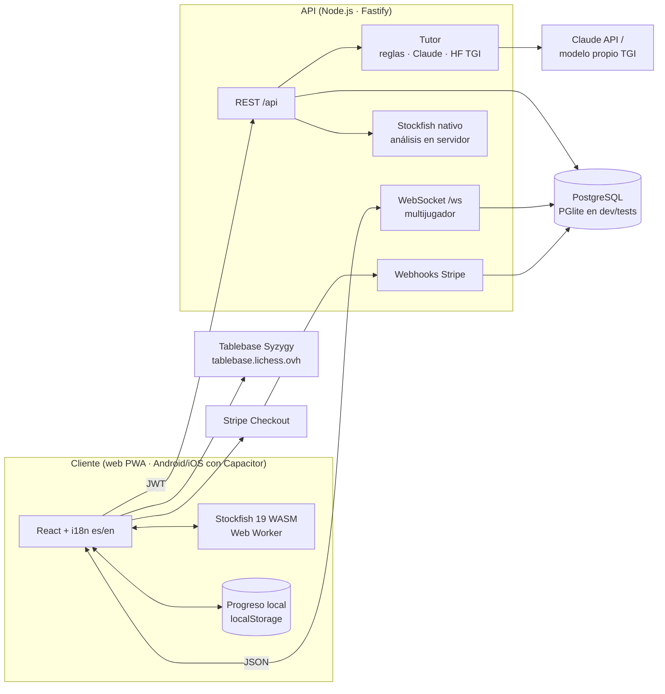
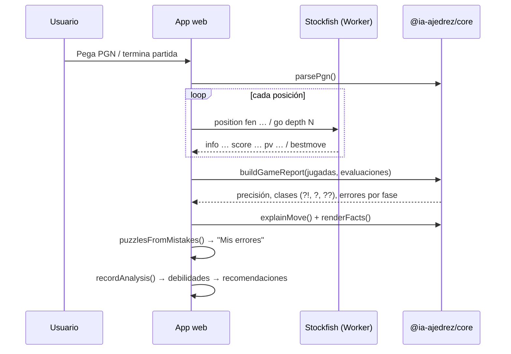
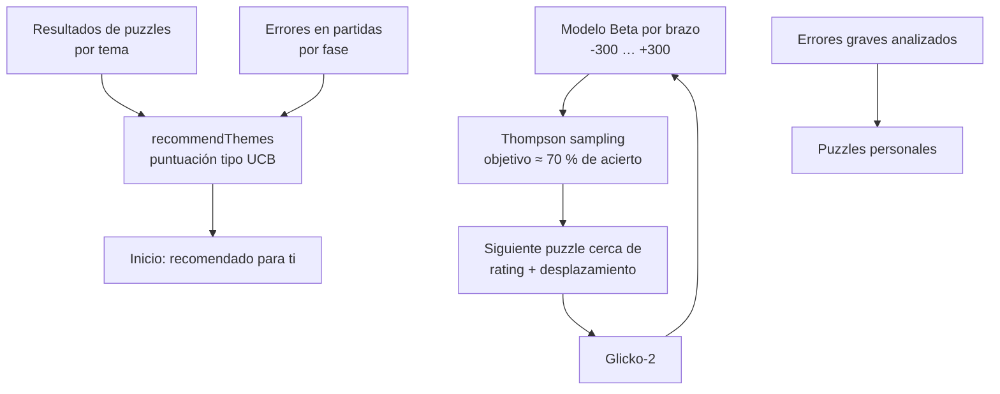
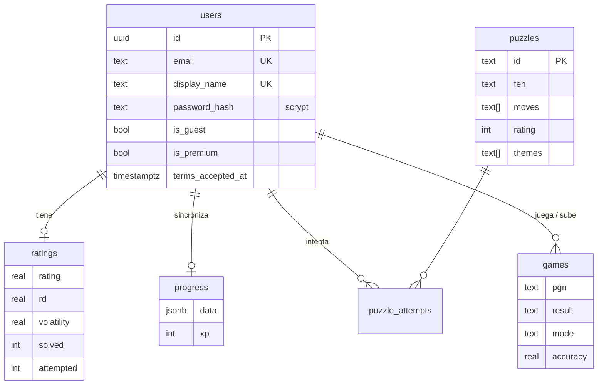

# Arquitectura

## Vista general



**Principio "local-first":** todo el entrenamiento (juego contra la IA, análisis, táctica,
aperturas, finales, lecciones, progreso e insignias) funciona en el dispositivo y sin conexión,
con Stockfish ejecutándose en el propio navegador. El servidor añade lo que necesita una fuente de
verdad compartida: cuentas, sincronización, rating de táctica validado, clasificación,
multijugador, tutor con IA generativa y pagos.

## Monorepo

| Paquete | Rol |
| --- | --- |
| `packages/core` | Lógica pura y testeada compartida por web y servidor: protocolo UCI, % de victoria y precisión (fórmulas de Lichess), clasificación de jugadas, informe de partida, Glicko-2, bandido de dificultad (Thompson), detección de debilidades, SM-2, XP/niveles/rachas/insignias/retos, PGN, puzzles (formato Lichess), tutor por reglas (es/en), aperturas y protocolo/reloj del multijugador. |
| `apps/web` | React 19 + Vite. Tablero propio accesible (clic, arrastre, coronación, flechas), cliente del motor, páginas de entrenamiento, PWA (service worker), i18n. |
| `apps/server` | Fastify 5 + Drizzle ORM. Auth JWT (scrypt), rutas REST, hub de multijugador, motor UCI, tutor, Stripe, métricas. |
| `apps/mobile` | Capacitor 8: empaqueta `apps/web/dist` como app Android/iOS. |
| `ml` | Python: preprocesado de PGN, generación de puzzles con motor, RL de dificultad, red de política (PyTorch) y tutor propio (Transformers). |

## Flujo de análisis de una partida



El tutor por reglas convierte la salida del motor en **hechos** (`hangingPiece`, `missedMate`,
`bestWasFork`, `losesMaterial`…). El tutor con LLM solo redacta a partir de esos hechos: no
puede inventarse evaluaciones ni variantes.

## Entrenamiento adaptativo



## Multijugador

```mermaid
sequenceDiagram
    participant A as Jugador A
    participant H as Hub (servidor)
    participant B as Jugador B
    A->>H: seek 3+2
    H-->>A: seeking
    B->>H: seek 3+2
    H-->>A: start (color, reloj)
    H-->>B: start
    A->>H: move e2e4
    H->>H: valida (chess.js) y descuenta reloj
    H-->>A: move + reloj
    H-->>B: move + reloj
    Note over H: temporizador de bandera;<br/>abandono si no reconecta en 30 s
    B->>H: resign
    H-->>A: end 1-0 + PGN
    H->>H: guarda la partida
```

El reloj es autoritativo en el servidor (arranca tras la primera jugada, con incremento). El hub
no depende del transporte, por eso se prueba con relojes y temporizadores simulados.

## Modelo de datos



Migraciones SQL versionadas en `apps/server/src/db/migrations.ts` (tabla `_migrations`).

## API

| Método | Ruta | Auth | Descripción |
| --- | --- | --- | --- |
| GET | `/health`, `/ready`, `/metrics` | — | Salud, preparación (BD) y métricas Prometheus |
| POST | `/api/auth/register` · `/login` · `/guest` | — | Cuentas (límite de intentos por IP) |
| GET · DELETE | `/api/me` | JWT | Perfil · supresión de cuenta (RGPD art. 17) |
| GET | `/api/me/export` | JWT | Exportación de datos (RGPD art. 15 y 20) |
| GET · PUT | `/api/progress` | JWT | Sincronización del progreso local |
| GET | `/api/puzzles/next?theme=` | JWT | Puzzle cerca del rating del usuario |
| POST | `/api/puzzles/:id/attempts` | JWT | Valida la solución **en el servidor** y actualiza Glicko-2 (solo cuenta el primer intento) |
| GET · POST | `/api/games` | JWT | Partidas del usuario (PGN validado) |
| GET | `/api/leaderboard?board=puzzle\|xp` | — | Clasificación (solo nombre visible) |
| POST | `/api/tutor/explain` | JWT (+Premium con LLM) | Explicación en lenguaje natural |
| POST | `/api/analysis/position` | JWT | Análisis con Stockfish en servidor |
| POST | `/api/payments/checkout` | Cuenta | Sesión de Stripe Checkout |
| POST | `/api/payments/webhook` | Firma Stripe | Activa/desactiva Premium |
| GET (WS) | `/ws?token=` | JWT | Multijugador |

## Seguridad

- Contraseñas con **scrypt** (OWASP), comparación en tiempo constante, verificación ficticia para
  no revelar si un correo existe.
- JWT de 30 días; los invitados no pueden pagar ni aparecer en el ranking.
- Validación de entradas con **zod**; límites de tamaño de cuerpo y de mensajes WebSocket.
- **Rate limiting** global y más estricto en autenticación; límite de chat por partida.
- Helmet (cabeceras), CORS por lista blanca, CSP en nginx/Vercel (`'wasm-unsafe-eval'` solo para
  Stockfish).
- El rating de táctica de la clasificación se calcula en el servidor reproduciendo las jugadas;
  la XP la declara el cliente (modo sin conexión) y se acota: no es apta para premios.
- Webhooks de Stripe con verificación de firma; nunca se manejan datos de tarjeta.
- El tutor con LLM trata la pregunta del alumno como texto no fiable y solo acepta códigos de
  hechos conocidos.
