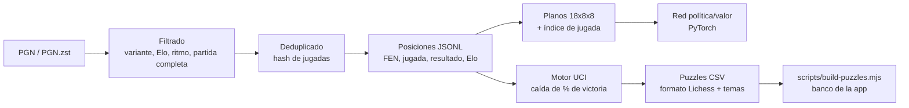

# Datos: fuentes y preprocesado

## Lo que ya incluye el repositorio

| Archivo | Contenido | Fuente y licencia |
| --- | --- | --- |
| `apps/web/src/data/puzzles.json` | 607 puzzles (rating 500–2800, 60+ temas) | [Base de puzzles de Lichess](https://database.lichess.org/#puzzles), **CC0** |
| `apps/web/src/data/openings.json` | 3 865 nombres de apertura (ECO + jugadas) | [lichess-org/chess-openings](https://github.com/lichess-org/chess-openings), **CC0** |
| `apps/web/src/data/repertoire.ts` | 10 líneas de repertorio con ideas (es/en) | Propio |
| `apps/web/src/data/endgames.ts` | 8 finales teóricos | Propio; resultados verificados con la tablebase Syzygy |
| `apps/web/src/data/lessons.ts` | 6 lecciones interactivas | Propio |
| `ml/data/sample.pgn` | Partidas históricas (Morphy 1858, Anderssen 1851) para tests | Dominio público |

Los tests (`apps/web/test/content.test.ts`) comprueban que **cada puzzle se resuelve con su
solución**, que el repertorio y las lecciones son legales y que los finales caben en la tablebase.

## Ampliar el banco de puzzles

```bash
curl -O https://database.lichess.org/lichess_db_puzzle.csv.zst
node scripts/build-puzzles.mjs lichess_db_puzzle.csv.zst --per-bucket 60
```

El script filtra puzzles populares (≥ 88), muy jugados (≥ 800) y con rating estable (RD ≤ 85), y
muestrea por tramos de 100 puntos y por tema para cubrir todo el rango. Si cambia el banco, el
servidor lo carga al arrancar con una base de datos vacía (`db:migrate`).

## Fuentes de partidas

| Fuente | Qué ofrece | Licencia / términos |
| --- | --- | --- |
| [Lichess Database](https://database.lichess.org/) | Miles de millones de partidas en PGN (dumps mensuales `.pgn.zst`), con Elo y control de tiempo | **CC0** |
| [TWIC](https://theweekinchess.com/) | Partidas semanales de torneos de élite | Revisa sus condiciones de uso antes de redistribuir |
| [PGN Mentor](https://www.pgnmentor.com/files.html) | Colecciones por jugador y apertura | Revisa sus condiciones; los movimientos son hechos, pero recopilaciones y comentarios pueden estar protegidos |
| [Chess.com PubAPI](https://www.chess.com/news/view/published-data-api) | Archivos mensuales de partidas de un usuario | Términos de Chess.com; solo datos del propio usuario con su permiso |

## Pipeline de preprocesado (`ml/`)



```bash
cd ml && pip install -e ".[dev,train,lichess]"
python -m ajedrez_ml.pgn_dataset lichess_db_standard_rated_2024-01.pgn.zst -o out/positions.jsonl \
    --min-elo 2000 --min-base-seconds 180
python -m ajedrez_ml.tactics out/positions.jsonl -o out/puzzles.csv --engine /usr/games/stockfish --limit 50000
python -m ajedrez_ml.train_policy --data out/positions.jsonl --epochs 5 --out artifacts/policy.pt --onnx artifacts/policy.onnx
```

1. **Parseo** con `python-chess`; se descartan variantes, partidas sin resultado o con errores.
2. **Filtros** de Elo mínimo y ritmo (sin bala) para aprender de partidas de calidad.
3. **Deduplicado** por la secuencia de jugadas (habitual al mezclar TWIC y Lichess).
4. **Representación**: FEN, jugada en UCI, resultado desde el bando que mueve; planos 18×8×8
   siempre desde el punto de vista del que mueve (técnica de AlphaZero/Leela).
5. **Etiquetado táctico**: una jugada que hace caer ≥ 15 puntos el % de victoria genera un puzzle
   si el rival tiene una única jugada claramente mejor (≥ 20 puntos sobre la segunda). Temas por
   heurísticas: mate en N, mate del pasillo, horquilla, clavada, pieza colgada, coronación y fase.
6. **División train/validación por partida** (no por posición) para no filtrar información.

## Datos de los usuarios

Se guardan solo los necesarios para el servicio: progreso, intentos de puzzles (para el rating y
el anti-abuso), partidas y estado Premium. Ver [LEGAL.md](LEGAL.md) para la base jurídica,
exportación y borrado.
